<div align="center">

# TaskPro

[](https://github.com/Ali-Nourix/Task-Pro)
[](LICENSE)
[](https://obsidian.md/plugins)
[](https://github.com/Ali-Nourix/Task-Pro)

**A powerful task management plugin for Obsidian**

[فارسی](README.fa.md) · [Features](#features) · [Installation](#installation) · [Development](#development)

</div>

An Obsidian plugin for task management: interactive chips on every task line,
your own coloured tags, a task board that shows every task in the vault in one
place (on a phone too), a calendar and a timeline to plan your days on in the
Gregorian or the Jalali calendar, subtasks and tasks that wait on each other,
bi-directional sync with a central task note, deadlines, priorities, and
per-task capabilities you add only where you want them.

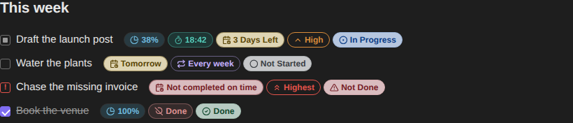

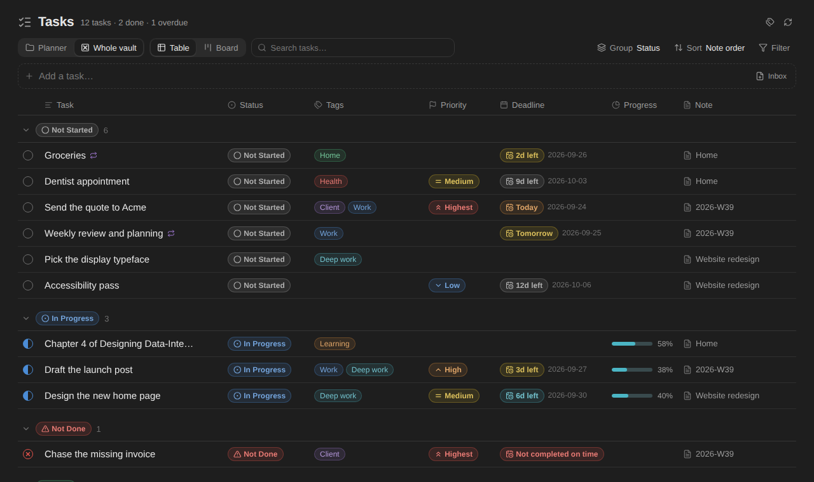

<sub>Rendered from the plugin's own code and `styles.css` over Obsidian's default
theme variables (see <a href="#previews">Development → Previews</a>), not
screenshots of a live vault.</sub>

## Contents

- [Features](#features)
- [Tags](#tags)
- [Task board](#task-board)
  - [Floating over everything](#floating-over-everything) · [On a phone](#on-a-phone) · [Keyboard](#keyboard) · [Selecting several tasks](#selecting-several-tasks) · [Views](#views) · [Moving a task](#moving-a-task)
- [Subtasks and waiting](#subtasks-and-waiting)
- [Timeline](#timeline)
- [Calendar](#calendar)
  - [Subtasks](#subtasks) · [The task menu](#the-task-menu) · [Plans](#plans) · [Daily notes](#daily-notes)
- [Per-task capabilities](#per-task-capabilities)
- [Requirements](#requirements)
- [Installation](#installation)
- [Setup](#setup)
- [Commands](#commands)
- [Task syntax](#task-syntax)
- [Bi-directional sync](#bi-directional-sync)
- [Reminders](#reminders)
- [Telegram bot](#telegram-bot)
- [Settings](#settings)
- [How it works](#how-it-works)
- [Development](#development)
- [Releasing](#releasing)
- [License](#license)

## Features

### Interactive chips

Every task line gets a row of chips, rendered through CodeMirror decorations in
Live Preview and a post-processor in Reading Mode. Nothing is written into your
notes to make them appear, and clicking one opens the menu for that property.

| Chip | Meaning |
| --- | --- |
| `Not Started` `In Progress` `Done` `Not Done` | Task status; click to change it |
| `Highest` … `Lowest` | Priority, five levels |
| `Every week` | Recurrence |
| `Tomorrow` `3 Days Left` `Not completed on time` | Deadline, coloured by urgency |
| `Today, 09:30 – 11:00` | When you [plan](#plans) to work on it |
| `18:42` | A running focus timer |
| `38%` | Progress through a set number of steps |
| `2/4` | How many of a parent task's [subtasks](#subtasks-and-waiting) are done |
| `Write the copy` `2 tasks` | Behind an hourglass: the tasks this one is [waiting on](#waiting-on-another-task); click to open one |
| `Work` `Client` | Your own tags, each in its own colour; click to change them |

### Chips that belong to your theme

Every chip is a tint of **one accent colour, taken from the theme you are
using** — nothing in the plugin is a fixed colour. So the same six chips read
correctly on Obsidian's defaults, on a light vault, and on a community theme
with a palette of its own:

<table>
<tr>
<td align="center"><b>Obsidian default · dark</b></td>
<td align="center"><b>Obsidian default · light</b></td>
</tr>
<tr>
<td></td>
<td>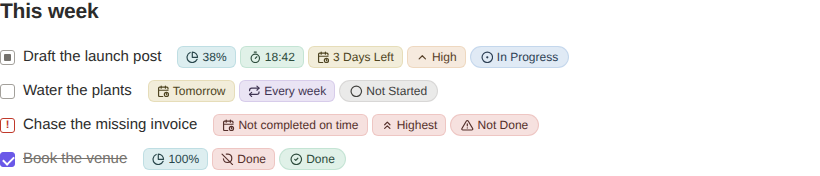</td>
</tr>
<tr>
<td align="center"><b>A community theme · dark</b></td>
<td align="center"><b>A community theme · light</b></td>
</tr>
<tr>
<td>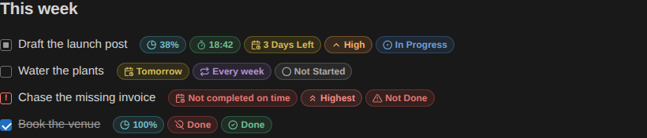</td>
<td></td>
</tr>
</table>

Status is the property people read first, so it is the one chip with a shape of
its own, a capsule; tags, priorities and dates stay rounded rectangles. The
capsule follows the chip radius setting, so squaring the chips squares it too.

A label is also pulled toward the theme's own text colour, which is what keeps
it readable in both modes from one declaration: it lightens on a dark theme and
darkens on a light one, because that is where the theme's text colour is. Every
chip variant is measured against WCAG AA (4.5:1) on each theme by
[`npm run check:contrast`](#previews) — the current worst case is 4.6:1.

If you want a specific hue anyway, each accent is a
[Style Settings](https://github.com/mgmeyers/obsidian-style-settings) knob,
along with how strongly chips tint themselves.

### Custom task statuses

`[/]` and `[!]` are drawn so they read at a glance, in Live Preview and Reading
Mode alike:

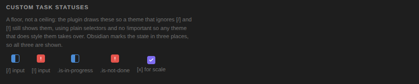

These are a floor, not a ceiling. Styling a checkbox is really a theme's job, so
the plugin uses plain selectors and no `!important` — a theme that styles these
states takes over with an ordinary rule, and one that ignores them still gets a
sensible default.

### Four-state task toggle

`Ctrl+T` cycles the task under the cursor through all four states:

```text
[ ] → [/] → [x] → [!] → [ ]
```

`[!]` means *not done* — for something that missed its moment rather than
something still open. Overdue tasks are moved into it automatically.

### Properties with `@`

On a task line, type `@` and the plugin lists what the task can be given — a
priority, a deadline (today, tomorrow, next week, or a date you pick), a plan,
a repeat rule, a tag, a status — filtered as you type, the way Notion's `@`
works. `@high`, `@tomorrow`, `@weekly` or a tag's name are enough. Choosing
one writes the marker through the same writers the menus use, so an existing
priority or deadline is replaced rather than doubled, and the `@word` you
typed is taken out again. Picking a tag the task already has takes it off. It
can be switched off under **Settings → TaskPro → Badges**.

### Task import and bi-directional sync

Import tasks from a central reference note (say `Weekly Tasks.md`) into any
note, and a status change on either side updates the other.

### Global internal tasks

Tasks stored in plugin settings rather than in a note, available in the import
modal alongside the reference note's own.

### Bilingual, with Jalali dates

Every chip and menu is available in English or Persian (فارسی), with correct
right-to-left text, and deadlines can be displayed and picked in either the
Gregorian or the Jalali calendar.

## Tags

Tags are your own labels for tasks — *Work*, *Client*, *Deep work*, *Home* —
each with a name and a colour you choose, so tasks can be told apart at a glance
and pulled apart on the [task board](#task-board).

<table>
<tr>
<td align="center"><b>Obsidian default · dark</b></td>
<td align="center"><b>A community theme · light</b></td>
</tr>
<tr>
<td>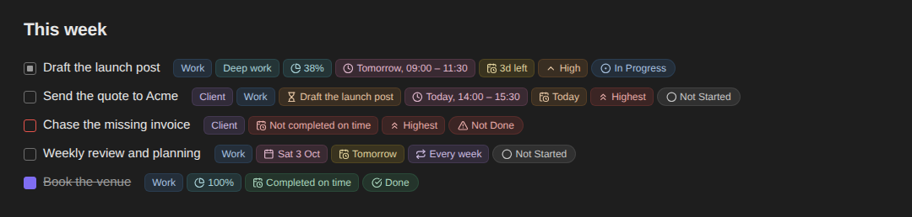</td>
<td>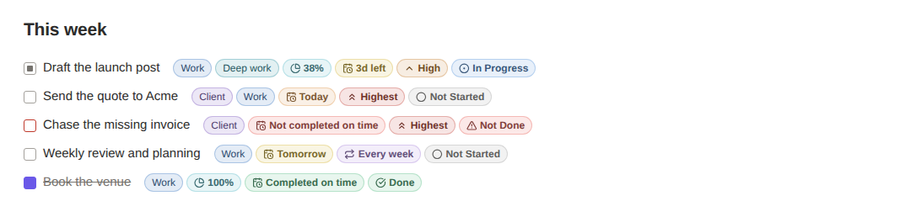</td>
</tr>
</table>

- **Add tags to a task** from its status chip (**Add Tags**), by clicking a tag
  chip, with **Set Tags on Current Task**, or from the task board. The picker
  works like a Notion multi-select: type to filter, `Enter` to toggle, and
  typing a name that does not exist yet offers to **create it on the spot**,
  with a colour.

  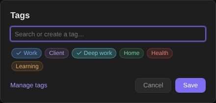 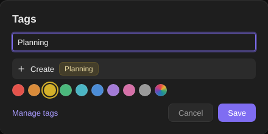

- **Colours come from your theme.** The palette is the theme's own red, orange,
  yellow, green, cyan, blue, purple and pink (plus grey), so a *blue* tag is
  your theme's blue in light and dark mode alike; a custom colour is there for
  anything else. Every palette colour passes WCAG AA as a chip label in both
  modes on every theme checked.
- **A note stores only the tag's key**, as `@tag(work, deep-work)`, hidden
  behind the chips while they are on. The name and colour live in the plugin's
  tag list, so renaming *Work* to *Office* or making it green updates every
  task at once without touching a note. Keys accept any script, so Persian tags
  (`@tag(کار)`) work as well as Latin ones.
- **Manage tags** under **Settings → TaskPro → Tags**, from the board, or with
  **Manage Tags**: rename, recolour, see how many tasks use each tag, and delete
  a tag either on its own (tasks keep the marker and show a grey chip until you
  define it again) or together with its marker in every note.

  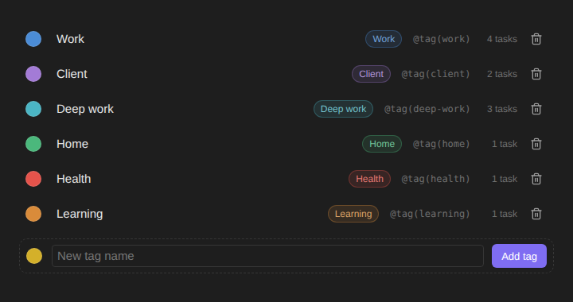

- Tags travel with a task: they are copied into an imported task and synced from
  a linked copy back to its source, like the other markers. Obsidian's own
  `#tags` are left alone — they are part of the task text and still searchable
  from the board.

## Task board

Every task in one place, the way a Notion database shows every row: open it from
the ribbon or with **Open Task Board**, and it opens as a tab of its own.

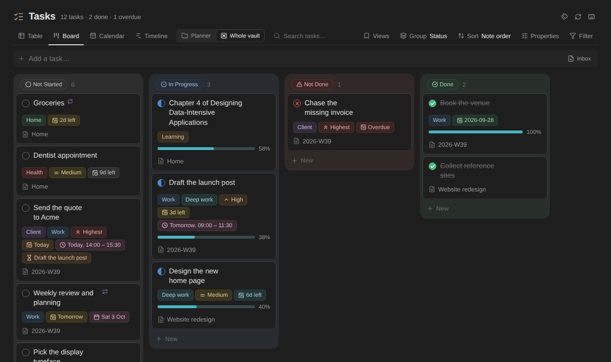

- **Scope:** the whole vault, or only the target folder set under **Settings →
  TaskPro → General**. The switch is at the top of the board, beside the tabs,
  and is there only when a target folder is set.
- **Four layouts,** as a row of tabs (the current one marked by a bar on the
  line under them, the way Notion marks its views): a **table** with a column
  per property, a **board** with a column per group (drag a card to another
  column to change its status, priority or tag), the [timeline](#timeline) and
  the [calendar](#calendar).
- **Group** by status, tag, priority, deadline (*Overdue*, *Today*, *Next 7
  days*, *Later*, *Past*), plan (*Missed*, *Today*, *Next 7 days*, *Later*,
  *Past*, *Not planned*) or note, and fold away groups you do not need; a
  task with two tags appears under both, as in a Notion multi-select.
- **Sub-items:** in the table a subtask sits one step in under its parent,
  whatever the grouping. A parent shows how many subtasks it has after its
  title, and a click folds them away and brings them back (the fold is kept).
  Only what is on the screen counts: a subtask whose parent is filtered out or
  in another group stands at the edge instead of hanging under nothing.
- **Sort** by title, status, priority, deadline, plan, progress or note —
  click a column header once, twice to reverse, a third time for note order.
- **Arrange the columns** the way a Notion view's properties are arranged:
  drag a header to move its column, drag its edge to resize it (double-click
  the edge for its default width), and right-click it to sort, move or hide
  it. The **+** at the end of the header row, or **Properties** in the
  toolbar, switches each property on or off and drags them into order; on the
  board it picks what a card shows. **Plan** shows the day and the hours
  (*Today · 09:30 – 11:00*), and **Repeat** can be switched on as a column.
- **Arrange the board's columns** too: drag a column by its header to move
  it, drag the edge between two columns to make every column wider or
  narrower, and use a column's **⋯** (or right-click its header) to hide it.
  Hidden columns are listed at the end of the board, one click from coming
  back. Grouped by tag, **New tag** there adds a column.
- **Waiting on** is a column of its own: what each task waits on, and a
  task that is still waiting shows an hourglass beside its title. The
  **Progress** column shows a parent's done subtasks (*2/4*) when it has no
  progress bar of its own. See [Subtasks and waiting](#subtasks-and-waiting).
- **Filter** by status, priority, tag, deadline (*Overdue*, *Today*, *Next 7
  days*, *Later*, *Past*, *None*), plan or note from a searchable menu, and
  **search** titles, tag names and note names. Active filters show as pills
  you can click away, and **Clear filters** takes them all off.
- **Density, wrapped titles and empty columns:** **Properties → View** sets
  how much room the table's rows and the board's cards take (compact,
  comfortable or spacious), lets a long title run over as many lines as it
  needs, and leaves out the board's columns that have nothing in them. A
  finger keeps its 44px whatever the density.
- **Edit in place:** tick a task off, change its status or priority from a menu,
  set the deadline, pick tags, or click a title to rename it. Every edit is
  written into the note the task lives in, keeping all of its markers, and a
  linked copy syncs to its source the same way it does from the chip menu.
  **↗** opens the note with the cursor on the task.
- **Right-click any task** — a row, a card, or a task on the calendar — or
  press its **⋯** button for the [task menu](#the-task-menu): every property
  a task can carry, one hover away. Its first row, **Open card**, opens the
  same card the calendar does, with a row for each property and the subtasks
  under them, from the table, the board and the timeline too; a table row's
  **Open** button and a card's own space do the same. Its **Copy link** and
  **Move to note…** are described under [Moving a task](#moving-a-task).
- **Add tasks** from the row at the top, from a board column's **New** button,
  or from the **New** row that ends each group of the table. A new task goes
  into the note of your choice and takes on the active filters (or the group it
  was added to), so it does not vanish from the view the moment it is created.
- **A wide table keeps its place:** the check and the title stay in view when
  the properties are scrolled sideways, and a group's name stays with them. A
  row's **↗** and a card's **⋯** appear on hover, as small raised buttons.
- The board remembers its layout, grouping, sort and filters between sessions,
  follows your notes live, and reads right to left in Persian:

  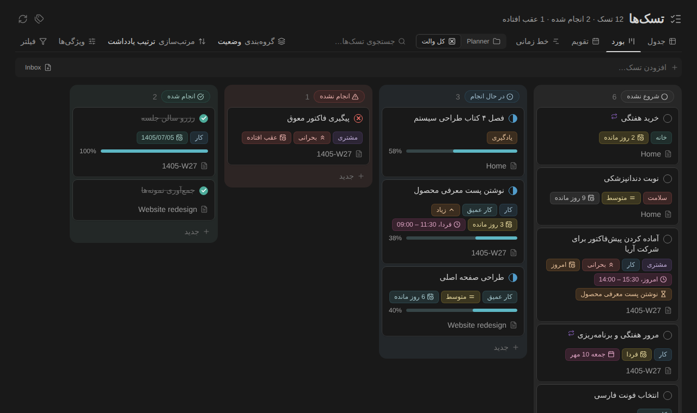

### Floating over everything

Press **`Ctrl+Shift+B`** (`Cmd+Shift+B` on macOS), or run **Toggle Floating
Task Board**, from anywhere — a note, the graph, another plugin's view — and
the board opens as a large floating window over the whole app. The same keys
close it again, as does `Esc`; the search field has focus as soon as it
appears, so you can start typing to find a task. **Open in a tab** in its
header sends it back to a workspace tab, and **Float over Obsidian** on the
tab's header does the reverse.

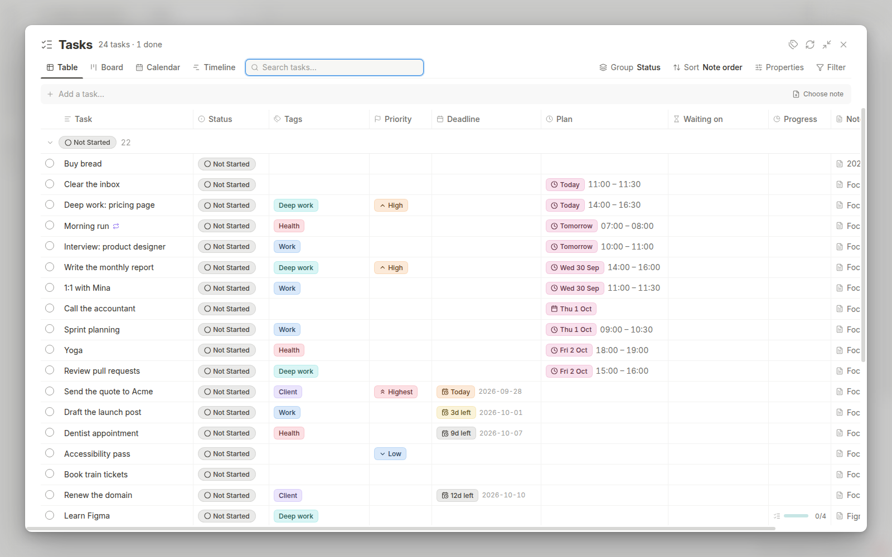

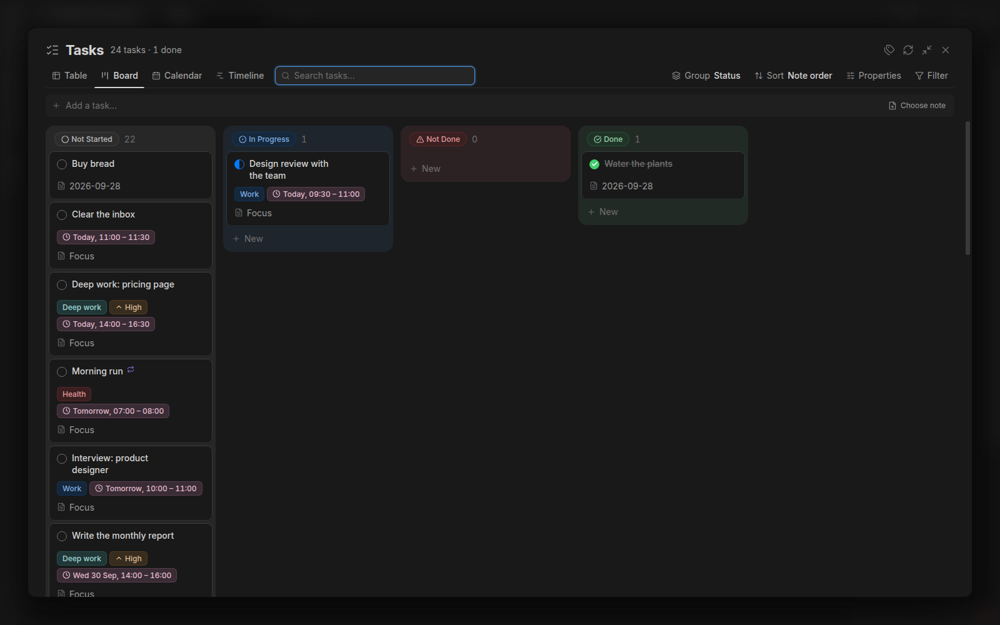

<sub>These two are screenshots of Obsidian 1.13.7 itself, with the Bookcloth
theme, not harness renders.</sub>

The plugin sizes the window and dims what is behind it. The blur belongs to the
theme: while the float is open the plugin puts `taskpro-board-is-floating` on
`<body>` and `taskpro-board-float` on the modal container, and a theme blurs
from those — [Bookcloth](https://github.com/Ali-Nourix/Obsidian-Theme) does, and
exposes the strength as a Style Settings slider. A theme that blurs should put
`filter: blur()` on `body > .app-container` (and `.titlebar`) rather than
`backdrop-filter` on the modal background: measured in Obsidian with the board
repainting every frame, `filter` holds 60 fps exactly as no blur does, while
`backdrop-filter` drops to about 26.

It stays quick on a large vault: notes the metadata cache says hold no tasks are
never read, only the lines Obsidian itself calls task items are parsed (so a
`- [ ]` in a code block is not a task), a changed note is re-parsed from the
content Obsidian already has in hand, and long groups are drawn 150 rows at a
time.

<table>
<tr>
<td>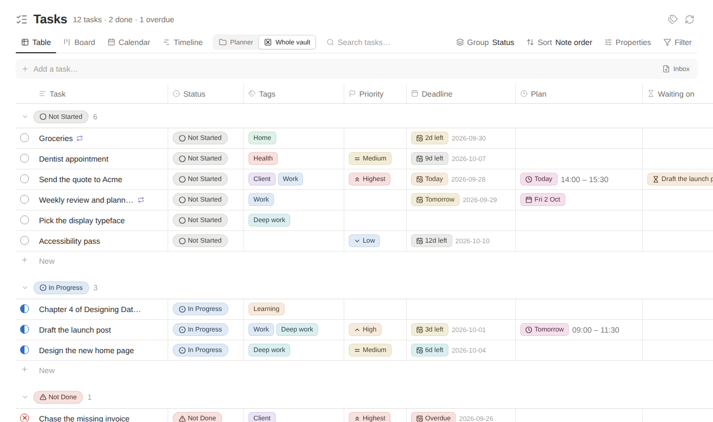</td>
</tr>
</table>

### On a phone

On a phone, or in a pane narrower than 640px, the board is rebuilt for a
thumb, and nothing is left out: every setting and action on the desktop is
still there, one or two taps in.

**The frame.** A slim bar on top (the title, search, filters, the view's
options and a **⋯** sheet), the layouts as **tabs along the bottom** (List,
Board, Calendar, Timeline, with the arrow keys moving between them), and a
round **+** above them. On the list the top bar and the tab bar step aside
while you scroll down and come back at the first scroll up; the list never
changes size when they go, so nothing jumps under your finger. The bottom keeps
clear of the home indicator and of Obsidian's own floating bar.

**Two fingers pulled down, anywhere, open the task board.** On a touch screen,
from a note or from any other view: put two fingers down together and pull
them straight down. Nothing happens while they are down: a pill at the top of the
screen follows the pull (*Pull down for the Task Board*, then *Release to open the
Task Board* with a short buzz once it is far enough), and the board opens when
**both fingers are lifted**. Pulling back up, or lifting early, cancels it, and
the list underneath never reacts to the two fingers (no tick, no sheet). It needs
a clear move (both fingers, a good way, quickly), so a scroll or a pinch does not
set it off. **Two-Finger Swipe Opens the Task Board** in the settings turns it off.

**The phone's back gesture goes back, one step at a time.** The board opens in the
pane you were in, as a step of that pane's history, so the system back (the
Android back button or swipe, Obsidian's two-finger swipe back) closes it and
returns to the note you came from. A sheet, a menu or the quick-add field that is
open takes the back first and closes; the next back leaves the board.

**Adding a task is one line of words.** The **+** opens a sheet with a field and
the keyboard. Type `call Sara tomorrow 9 #work !high` (or
`خرید نان فردا ساعت ۹ #کار !بالا`) and what was understood shows under it as
chips: a plan for tomorrow at 09:00, high priority, the tag. `remind …` /
`یادآوری …` makes a reminder, `due …` / `مهلت …` a deadline, `in 20 minutes` /
`۲۰ دقیقه دیگه` a reminder from now. A reading you did not mean has a **✕** that
keeps the words in the title. Prefer to tap? Today, Tomorrow, a month to pick a
day from, priority, tags and reminders are buttons under the field that write
the same words into it. A task with a day goes into that day's note (as on the
calendar), the rest into the inbox; **Add** clears the field and keeps the
keyboard for the next one. It reads the same lines as the Telegram bot does.

**Rows are light.** A task is its title and one calm line of small text under
it (when, how urgent, its tags, how far along); only what is overdue, due today
or urgent takes a colour. The chips are one tap in, in the task's sheet, or
back for good with **Row style › Chips** in the board's options. The circle is
24px with a 44px target, a swipe towards the trailing side ticks the task off
(the other way opens its sheet), with a buzz when it is far enough to count and
dragging back before letting go to cancel it; either way a line at the foot says
what happened with **Undo**. A second finger put down on a row cancels its swipe
and its long press, so a two-finger gesture never ticks anything.

**A task's sheet starts with what you most often do**: Today, Tomorrow, Next
week and **Pick a date…** to plan it, and **Done** as a large button at the foot
that stays in view while the rows scroll. Menus, cards and pickers all rise from
the bottom with a handle to drag them down by; a submenu is a page of its own.

- **The table becomes a list**, as above. **Table style** in the board's options
  brings back the full table, which then scrolls sideways.
- **The board shows one column at a time**: a swipe sideways moves the strip with
  the finger and settles on the next column, never past it (a quick flick, or
  a drag of a fifth of the screen, is enough; a short one comes back), with a
  short buzz. A tap that ends a swipe is not a tap. Each column scrolls up and
  down by itself and keeps its place while you visit the others, and a row of tabs
  above it says where you are and jumps between them. (The strip is moved by
  the plugin rather than by the browser's own pan: where a column that scrolls
  vertically sits inside a strip that scrolls sideways, some engines drop the sideways
  pan.)
- **The calendar's bar is two lines**: the period with back, forward and Today,
  and under it Month, Week, Day, Agenda, the unscheduled tasks and a **⋯** sheet
  (Gregorian or Jalali, what to show). The month is a grid of dots with the
  chosen day's tasks under it, and a swipe across it turns the page; the week
  shows three days from today and scrolls sideways.
- **A long press is the right click**, and anything that can be dragged, a card,
  a block or a bar, is picked up by holding it still for a moment, so a finger
  that moves right away scrolls.

**For everyone.** Every control has a name a screen reader can say (a checkbox is
named for its task and says whether it is ticked), is at least 44px (24px at the
smallest, with a bigger touch area made around it), and shows where the keyboard
is. A sheet shuts the board behind it away until it is closed, Tab goes round
inside it, and Esc or a way out of its own closes it and gives the focus back.
What happens is said aloud too: the period on the calendar, a task added, a task
ticked off with its Undo. Text can grow with Obsidian's font size (the bars grow
with it), more contrast and forced colours are honoured, and nothing needs a
gesture that a button does not also do.

<table>
<tr>
<td>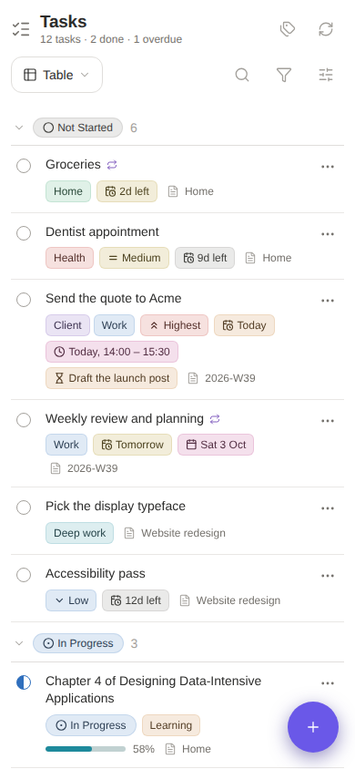</td>
<td>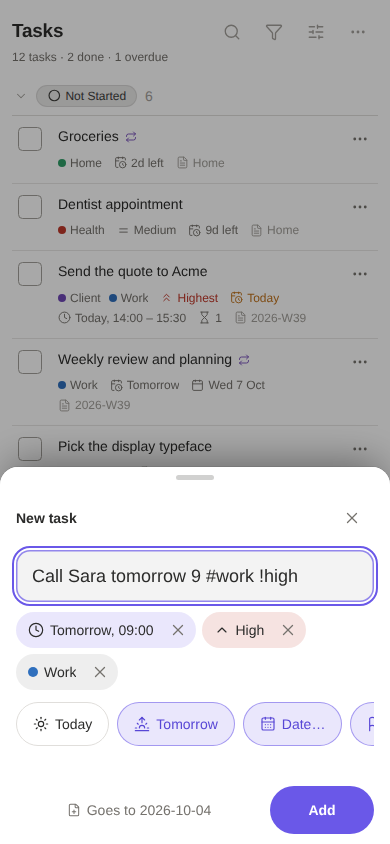</td>
<td>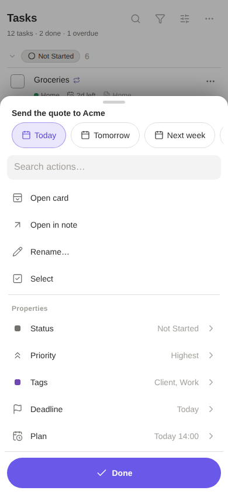</td>
<td>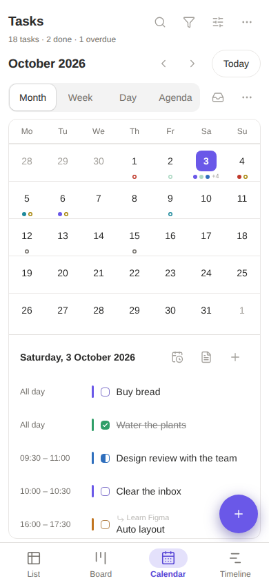</td>
</tr>
</table>

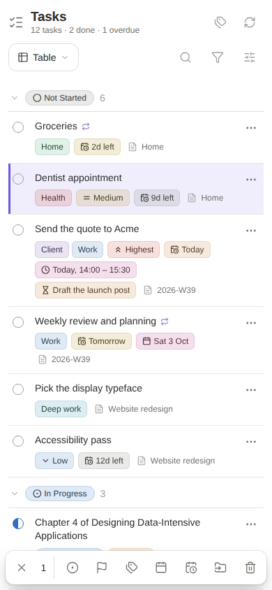

The board uses the phone layout wherever it is narrow, so a sidebar pane on a
desktop gets it too, and a touch screen keeps the larger targets at any width.

### Keyboard

The table and the board have a cursor that moves through the tasks the way the
eye does, and a key for each thing you do to the task under it. Press **`?`**
(or the keyboard button in the header) for a sheet that lists them all.

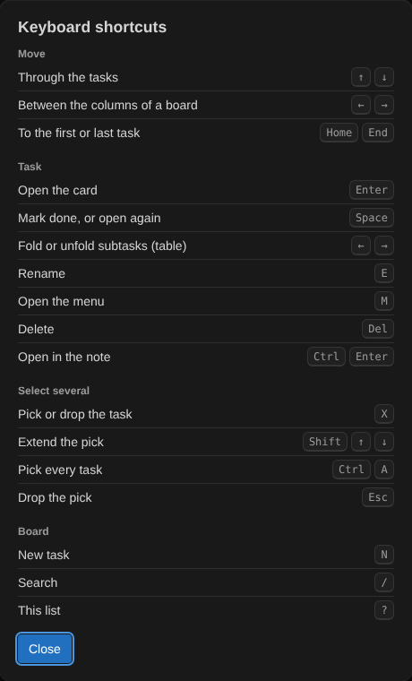

| Key | Does |
| --- | --- |
| `↑` `↓` (or `K` `J`) | Move through the tasks |
| `←` `→` | Between a board's columns (mirrored in Persian); in the table, fold and unfold a parent's subtasks, and `←` from a subtask steps up to its parent |
| `Home` `End` | The first and the last task |
| `Enter` | Open the task's card |
| `Ctrl`/`⌘` `Enter` | Open its note, with the cursor on the task |
| `Space` | Tick it off, and back |
| `E` | Rename it |
| `M` | Open its menu |
| `Delete` | Remove it (**Undo** is offered) |
| `X`, `Shift` `↑` `↓`, `Ctrl`/`⌘` `A` | [Select](#selecting-several-tasks) it, a run of them, all of them |
| `N` | Go to the new-task field |
| `/` | Go to the search |
| `Esc` | Close the innermost thing open: a menu, a card, the selection, then the board |

Letters are read from the physical key, so they work on a Persian keyboard
layout as they do on a Latin one. Menus, cards and inline edits give the focus
back when they close, so the keys carry on where they were, and the cursor
never slides the table sideways.

### Selecting several tasks

A square in a row's margin, and on the corner of a card, picks it. `Ctrl` or
`⌘` with a click picks one more, `Shift` with a click picks a range, and
**Select** in the task menu starts a selection (on a phone, taps then carry it
on). Picked tasks are tinted and stay picked while the notes change under them.

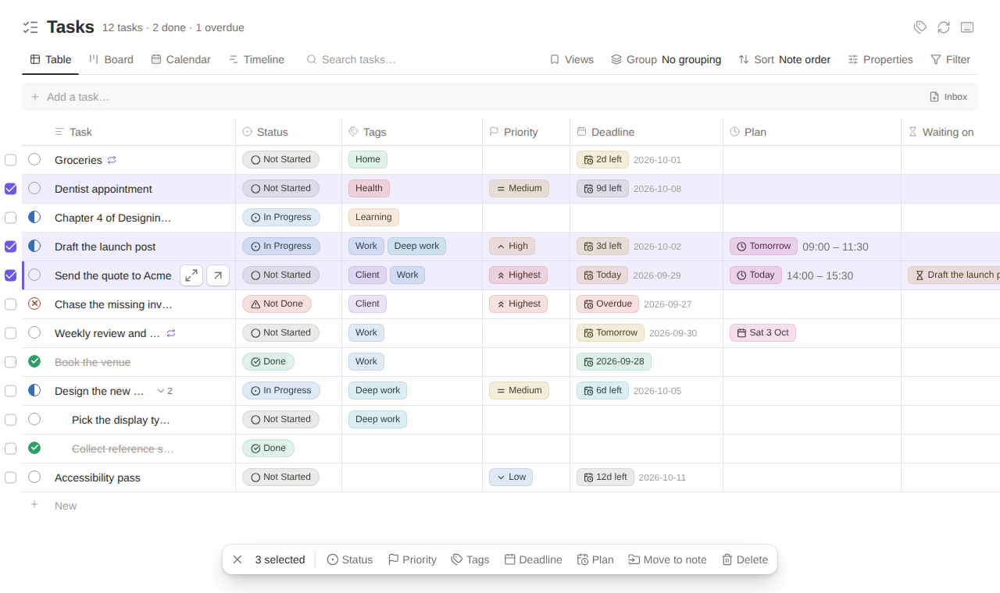

A bar rises over the board with what can be done to all of them at once:
**status**, **priority**, **tags**, **deadline**, **plan**, **move to a note**
and **delete**. Its menus are the ones a single task has, built from a stand-in
task that has only what all the picked share (a status they all have is
ticked), and each choice is made on every picked task in turn. A move or a
delete takes a parent's subtasks with it once, even when they are picked too,
and deleting several puts up one notice whose **Undo** puts every one back
where it was. `Esc` drops the selection before it closes anything under it.

On a phone the bar rises above Obsidian's own floating bar, with icons and the
count alone so that every action fits.

### Views

**Views**, in the toolbar (a page of the options sheet on a phone), lists the
views you have saved, saves the board as it is now, and puts a saved one back,
the way a Notion database keeps its views: *This week*, *Overdue and today*,
*By note*.

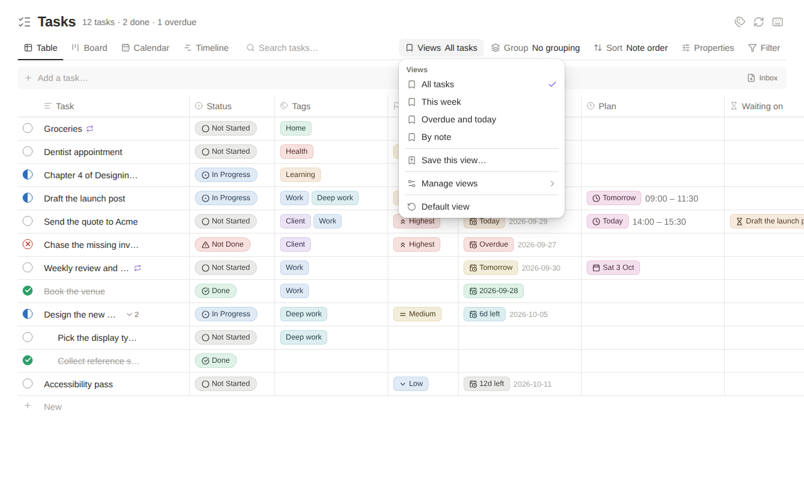

- A view holds what makes the board look as it does: the layout, grouping,
  sort, filters, properties and density, and the calendar's and the timeline's
  options. It leaves out the search, the groups and parents you folded, and
  the note new tasks go into.
- Applying a view sets every one of those to the view's value or to the
  default, so a view means the same board whatever it was applied over.
- The button shows the view's name, with a dot once the board has been changed
  since; **Update** takes the change into the view. Views can be renamed,
  duplicated and deleted, and **Default view** puts everything back.

### Moving a task

**Copy link** in the task menu copies a `[[Note#^id]]` block link to the task,
writing the block ID into the line when it has none. **Move to note…** lists
every note in the vault in a searchable menu: the inbox first, then the notes
beside the task's own, then the ones that hold tasks.

- The task goes with everything nested under it, and is set down at the left
  edge of the other note. A block ID the other note already uses is swapped for
  a new one.
- What TaskPro keeps about a task outside its line goes with it: its progress
  bar, its timer, and the sync mapping between a copy and its source.
- The links that say a task waits on another are rewritten, both on the tasks
  that moved and on the tasks elsewhere that wait on them.
- A note that cannot be written to gets the task back exactly where it was.

## Subtasks and waiting

A task nested under another in its note is its **subtask**. A parent task
with no progress bar of its own shows how many of its subtasks are done, as
a `2/4` chip in the note and in the board's **Progress** column, and the chip
fills in as they are ticked off. Only direct subtasks count; a plain bullet in
between does not break the link. **Show Subtask Progress** under Badges
switches it off.

### Waiting on another task

A task can wait on others: it cannot start until they are done. Choose
**Waiting on › Wait on a task…** in its [menu](#the-task-menu) and search for
the task; add as many as it needs. The line gets a marker made of links to
those tasks:

```markdown
- [ ] Write the copy ^copy
- [ ] Publish @waiting([[Launch#^copy]], [[Launch#^review]])
```

A task waited on gets a block ID the first time, so the link survives
renames and moves, and Obsidian's own backlinks show who is waiting on it. In
the note the marker is shown as a chip with an hourglass that names the task
(or says *2 tasks*, with the names in its tooltip) and opens it on a click.
Once every one of them is done, the hourglass turns into a double tick.

- The menu lists what a task waits on, each with **Stop waiting**, and also
  the tasks waiting on this one.
- On the board, a waiting task shows an hourglass, and on the
  [timeline](#timeline) its bar is hatched with an arrow from each task it
  waits on.
- A task cannot wait on itself or on a task that waits on it, however far
  round the chain.

## Timeline

The board's fourth layout lays tasks out as bars across days, as a Gantt chart
does: a bar runs from a task's plan to its deadline, a task with only a
deadline is a diamond on that day, and a parent's family is spanned by a thin
bracket over its subtasks' bars. The list of titles stays pinned on one side
and the scale of days on top.

- **Drag a bar** to move the task: its plan and its deadline move together,
  keeping the plan's time of day. Drag its start to change the plan, or its
  end to change (or set) the deadline. A label follows the pointer with the
  dates it will get. A click, rather than a drag, opens the task's menu.
- **Days, Weeks, Months** zoom the scale; **Earlier**, **Later** and **Today**
  move along it, and Gregorian or Jalali dates come from the same switch as
  the calendar.
- **Arrows** join each task to the tasks it is [waiting on](#waiting-on-another-task),
  red when the one it waits on is planned to end after it starts.
- **Today** is a red line down the chart that starts with a dot under today's
  number; weekends are shaded.
- A deadline before the task's plan is flagged on the deadline's day.
- **Tasks with no dates** are folded away under the chart; open the section
  and click a day in a task's row to plan it for that day.
- In Persian the chart runs right to left, and dragging to the left is later.

## Calendar

The board's third layout, next to **Table** and **Board** (or **Open Task
Calendar** from anywhere). It shows every task that belongs to a day — one you
planned for it, one due that day, or one written in that day's note — so you
can decide what to work on and when, in the Gregorian or the Jalali calendar.

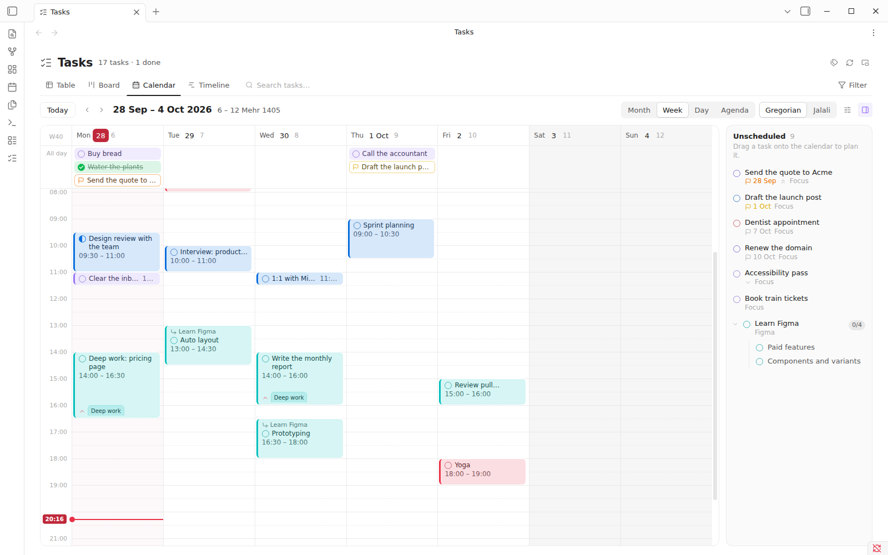

- **Four views:** **Month**, **Week**, **Day**, and **Agenda** (the next 14
  days as a list). With the calendar focused, `M` `W` `D` `A` switch views,
  `T` goes to today, the arrow keys step back and forward, and `N` adds a task.
  The keys go by position on the keyboard, so they work on a Persian layout
  too.
- **Gregorian or Jalali,** switched in the bar at the top. The other calendar's
  date is shown small beside every day. A Jalali week starts on Saturday with
  Friday as the weekend, and a Gregorian one starts on Monday (the start can
  be changed under **Week starts on**). In Persian the calendar reads right to
  left.

  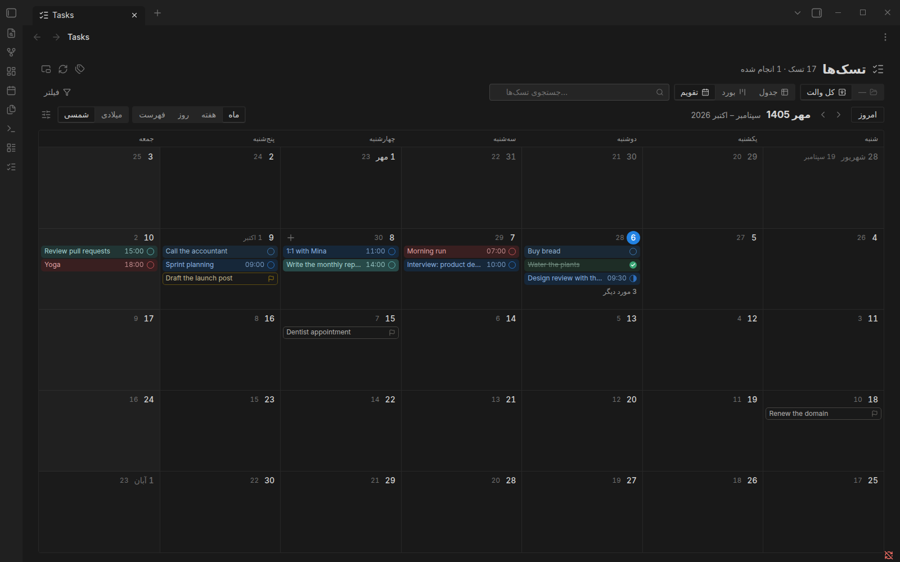

- **Plan a block of time:** drag across the week or day grid. A click on an
  empty slot only marks it, with a faint dashed block in the slot, the shape
  of the task that would go there, holding a **+** and the time at its start,
  always in the same place, so a stray click never opens anything; click the
  block to plan there. One panel is open at a time: a card and the task menu replace each
  other rather than stack. A card
  opens on the spot: type a title and press `Enter` to create a new
  task there, or choose one of the tasks you already have to plan it for that
  time. The times are typed, not picked: `9`, `930`, `2:30 pm` and `21:30` all
  work, and the arrow keys move a time by one step.

  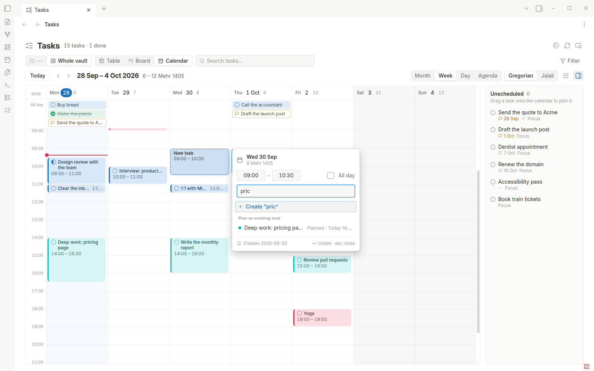

- **Move and resize** by dragging: a block to another hour or day, its bottom
  edge to change how long it lasts, a task onto the all-day row to keep the day
  but drop the time, and a task onto the sidebar to unplan it. `Esc` cancels a
  drag.
- **Unscheduled** lists the open tasks with no plan yet; drag one onto the
  calendar to give it a time.
- **Click a task** to open its card, laid out like a Notion page: the task it
  is part of, the title with its checkbox, then one row per property — when,
  status, priority, deadline, repeat, tags, note — with the name on one side
  and the value on the other, then its subtasks. Click a title to rename it,
  edit the time in place, or click any other value for its choices right under
  it; an empty one says so, faintly. **⋯** and a right click open the
  [task menu](#the-task-menu).

  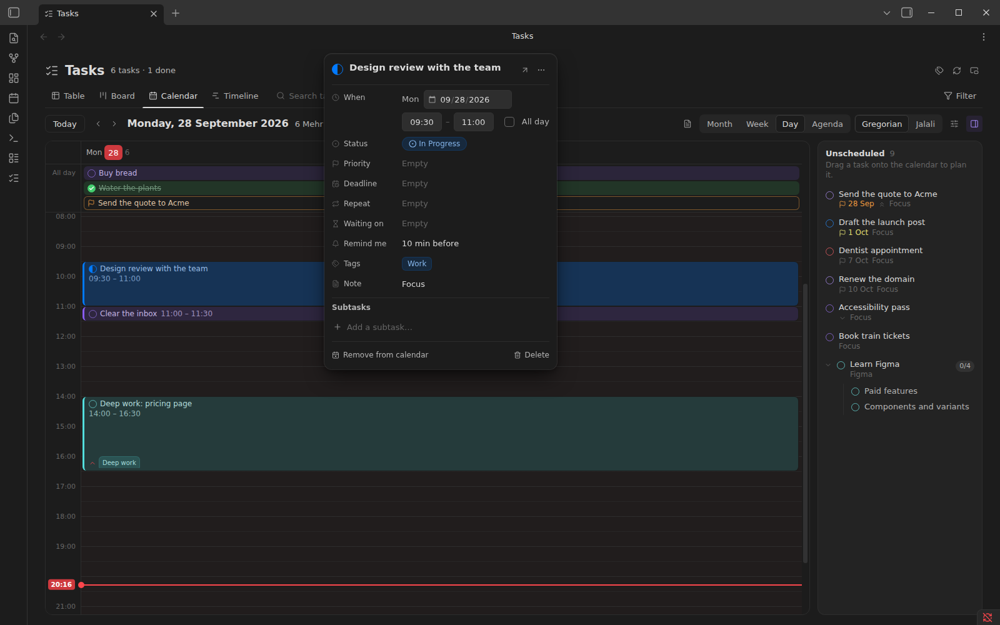

- **Deadlines** show as outlined flags on the day they fall. Dragging one
  plans it for that time and leaves the deadline where it is: the plan is when
  you will do it, the deadline is when it is due.
- The options button (the sliders next to the calendar switch) turns
  deadlines, tasks from daily notes, and done tasks on or off.
- **The time it is:** in the week and day views a red line crosses today, and a
  small label in the gutter, level with it, tells the time (in your clock
  setting); the hour mark it would sit on is hidden while it is there.

  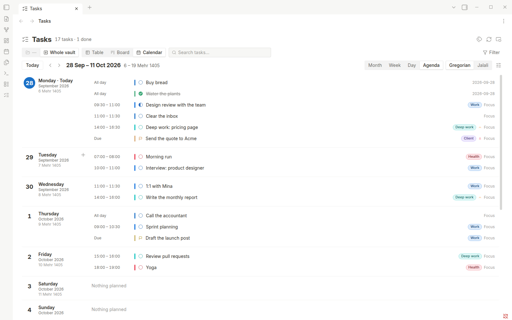

<table>
<tr>
<td align="center"><b>Month · Gregorian</b></td>
<td align="center"><b>Week · Jalali, in Persian</b></td>
</tr>
<tr>
<td>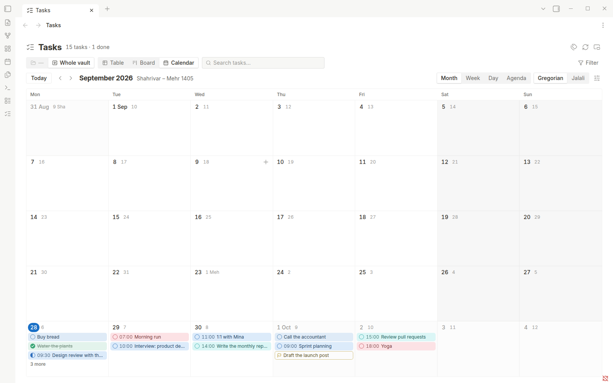</td>
<td>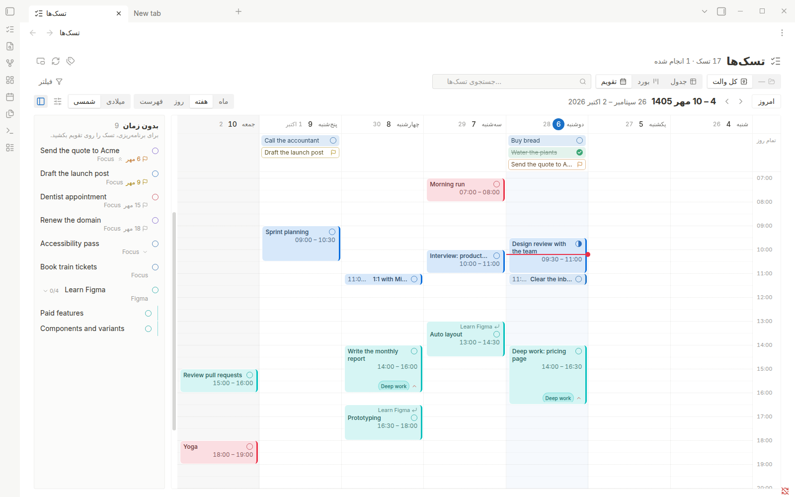</td>
</tr>
</table>

<sub>The screenshots in this section are of Obsidian 1.13.7 itself, not harness
renders.</sub>

### Subtasks

A task nested under another in its note is its subtask, and the calendar shows
the family together while each subtask is still planned on its own:

- A subtask with no tag of its own takes its parent's colour, and a block with
  room for it names the parent above its title.
- Hovering any member outlines the rest of its family on screen, however far
  apart they are planned.
- **Unscheduled** shows a family as a tree, as Notion's sidebar does: the
  parent with a toggle before it and how many subtasks are done after it, and
  the subtasks under it on a thin guide line, in note order. A parent that is
  already planned stays there, muted, to hold its open subtasks.
- A parent's card lists its subtasks with a checkbox and when each is planned,
  opens any of them with a click, and takes a new one in the **Add a
  subtask** field. A subtask's card links back to its parent.

A plain bullet between a task and its subtask, such as a note written under
it, does not break the link.

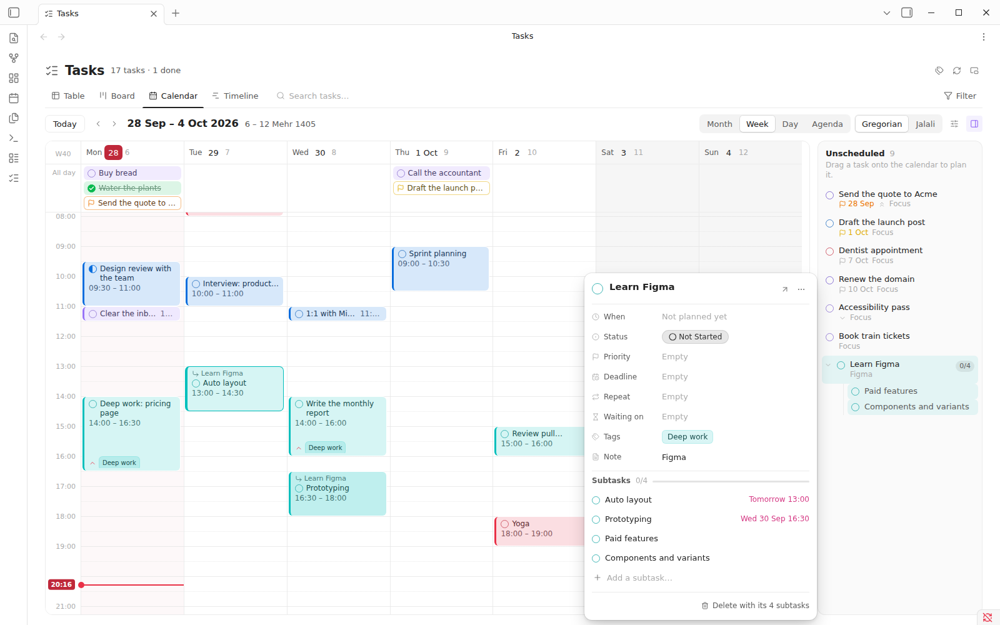

### The task menu

Right-click a task on the board or the calendar for a Notion-like menu of
everything the task can carry: status, priority, tags, deadline, plan,
repeat and progress, each with its current value beside it and its choices in
a submenu (Tags lists every tag, ticked when the task has it, and a way to
create one). Below them are **Add a subtask**, **Duplicate** (the copy goes
after the task and its subtasks), the full chip menu for the focus timer
and sync, and **Delete**.

**Delete** takes the task out of its note, together with everything nested
under it (its subtasks and the notes written beneath it), and says so when
there are subtasks: *Delete with its 2 subtasks*. A notice then offers
**Undo** for a few seconds, which puts the lines back exactly as they were.
It is also at the foot of a task's card, and the `Delete` key does it for a
task that has focus on the calendar. **Remove from calendar** is different:
it only takes the plan off, and the task stays in its note.

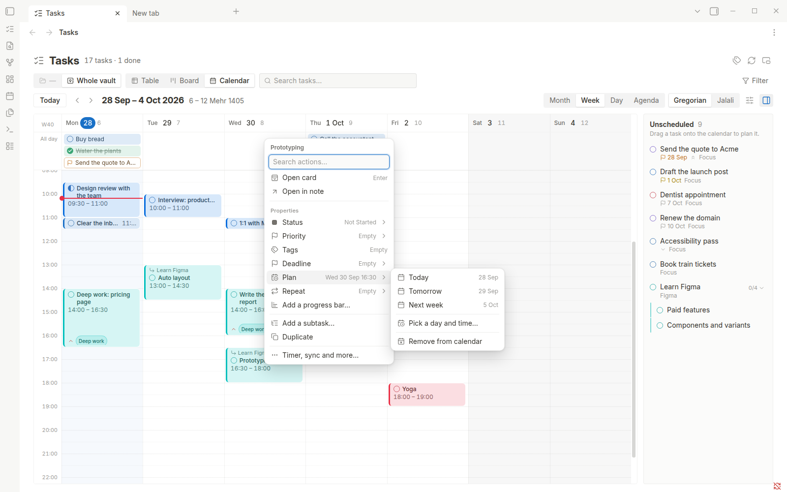

- Type straight away to search: `high` finds **Priority › High**, `week`
  finds **Repeat › Every week** and **Plan › Next week**. English words work
  in the Persian menu too.
- The arrow keys move through it, the forward arrow opens a submenu and the
  back arrow closes it (mirrored in Persian), `Enter` chooses, and `Esc`
  closes the innermost panel first.
- A right click on an empty slot offers a new task at that time, the day's
  note, or the day on its own.

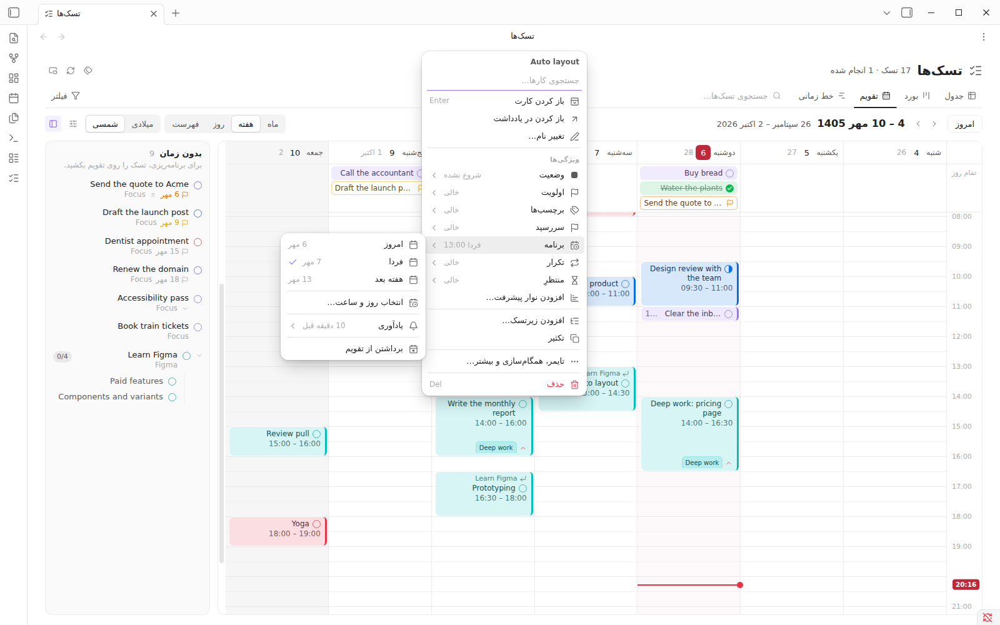

### Plans

A plan is written into the task line: `@schedule(2026-09-28 09:30-11:00)`, or
`@schedule(2026-09-28)` for the whole day. In Live Preview and Reading Mode it
is hidden behind a pink chip such as `Today, 09:30 – 11:00`, which turns grey
once the day has passed with the task still open. To plan from a note, use
**Plan a Time…** in the task's menu (click any of its chips) or run **Plan
Current Task…**.

A plan belongs to one copy of a task. It is not synced to a linked source, and
importing a task leaves the source's plan behind. A repeating task moves its
plan forward along with its deadline and keeps the time of day, so a weekly
09:00 block stays a weekly 09:00 block. A task with a plan and no deadline
repeats by the plan and is not given a deadline.

### Daily notes

Every day can have a note of its own, named after its date: **in English when
the Gregorian calendar is showing, and in Persian when the Jalali one is**. A
task you create on a day goes into that day's note. If the note does not exist
yet, it is created from your template, with the task already in it. Any task
written in a day's note shows on that day, even without a plan.

Set these up under **Settings → TaskPro → Calendar**:

| Setting | What it does |
| --- | --- |
| **Folder** | Where daily notes are kept (`Daily` by default) |
| **Gregorian name** / **Jalali name** | The name formats: `YYYY-MM-DD` and `jYYYY-jMM-jDD` by default |
| **Name new notes with** | The calendar showing, or always Gregorian, or always Jalali |
| **Template** | The note a new daily note starts from |
| **Put new tasks under** | A heading such as `## Tasks`, added if the note does not have it yet; leave it empty to add tasks at the end of the note. The note is kept tidy: a blank line between the heading and its list, a new task joining the list already there, and a blank line before the next heading |
| **Use Obsidian's Daily notes settings** | Copies the folder, format and template from the core Daily notes plugin |

A preview under the name settings shows today's note path in both calendars as
you type.

**Name formats** use these tokens. Text in `[brackets]` is kept as it is, and a
`/` makes subfolders, so `YYYY/MM/YYYY-MM-DD` files each day under its year and
month:

| Gregorian | Jalali | Gives |
| --- | --- | --- |
| `YYYY` `YY` | `jYYYY` `jYY` | Year: `2026`, `26` / `1405`, `05` |
| `MM` `M` | `jMM` `jM` | Month number: `09`, `9` / `07`, `7` |
| `MMMM` `MMM` | `jMMMM` `jMMM` | Month name: `September`, `Sep` / `مهر` |
| `DD` `D` `Do` | `jDD` `jD` `jDo` | Day: `28`, `28`, `28th` / `06`, `6` |
| `dddd` `ddd` `dd` | | Weekday name, in the naming calendar's language |
| `W` `WW` `GGGG` | | ISO week number and ISO week year |

**Templates** can use `{{title}}` (the note's name), `{{date}}` and
`{{date:FORMAT}}` (with any token above, Jalali ones included), `{{time}}`,
`{{weekday}}`, `{{gregorian}}` and `{{jalali}}` (the day in each calendar), and
`{{yesterday}}` and `{{tomorrow}}` (the names of the notes on either side, so
`[[{{yesterday}}]]` links back a day). If
[Templater](https://github.com/SilentVoid13/Templater) is installed, its
commands in the template run as well.

A day never gets two notes. Before a note is created, the day's name in both
calendars is checked, so a note made while the Gregorian calendar was showing
is still found from the Jalali one. If you would rather keep planned tasks in
one place, set **Tasks made on a day go into** to the board's inbox note; each
task then carries the day in its `@schedule` marker.

## Per-task capabilities

Three capabilities can be attached to any task, in any combination. Click a
task's status chip and pick one under **Add Capability** — nothing is switched
on until you ask for it, so a plain task stays a plain task.

| Capability | Chip | Stored in |
| --- | --- | --- |
| **Progress bar** | `38%` | Plugin data, keyed by the task's block ID |
| **Focus timer** | `18:42` | Plugin data, keyed by the task's block ID |
| **Repeat** | `Every week` | The task line itself, as `@repeat(1w)` |

### Focus timer

A countdown attached to one task, for the "I'll give this twenty-five minutes"
way of working.

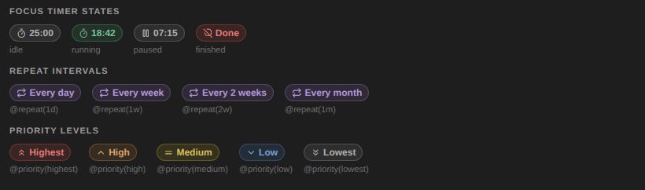

- Click the chip to start, pause, add 5 or 15 minutes, reset, change the
  duration, or remove the timer.
- The running timer also sits in Obsidian's status bar; clicking it opens the
  note the task lives in.

  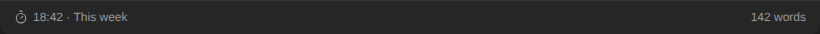

- When time is up you get an in-app notice, an optional sound, and a **desktop
  notification** naming the task — on Windows that arrives as a system toast
  and stays in the Action Center, so you see it with Obsidian in the
  background. Permission is asked for once.
- Remaining time is read from timestamps rather than counted down in memory, so
  a timer keeps running while Obsidian is closed and comes back with the right
  time left — or already finished — when you reopen the vault.
- **Start / Pause Focus Timer on Current Task** does the same from the keyboard,
  creating a timer at the default duration if the task has none.

Defaults live under **Settings → TaskPro → Capabilities**: duration, desktop
notification, sound, and the status-bar readout.

### Repeat

What a planner actually needs from a task that comes back.

- Presets for every day, week, two weeks and month, plus a custom interval of
  any number of days, weeks or months.
- Ticking off a repeating task **rolls it forward instead of closing it**: the
  deadline moves to the next occurrence, the status returns to `[ ]`, and any
  progress bar or focus timer on the task resets with it.
- The next date is counted from the task's own deadline, so a weekly task keeps
  its weekday even when you tick it off two days late. A deadline already in the
  past is advanced until it lands in the future — clearing a month of missed
  dailies leaves one task due tomorrow, not one due last week.
- Month intervals clamp instead of spilling: a task due on the 31st repeats on
  the 30th in a 30-day month.
- The rule lives in the task line as `@repeat(1w)`, so it survives moving,
  syncing and sharing the note. The marker is hidden behind the chip while that
  chip is on.
- Rolling forward works however the task was completed — the chip menu, the
  Reading Mode checkbox, `Ctrl+T`, or typing `[x]` by hand.

## Requirements

- Obsidian **1.5.0** or newer (this is the plugin's `minAppVersion`).
- Desktop or mobile. Two features are desktop-only in practice: the status-bar
  timer readout and the system notification when a timer ends.

## Installation

1. From the [latest release](../../releases/latest), download either
   `taskpro-<version>.zip` or the three loose files `main.js`,
   `manifest.json`, and `styles.css`.
2. Create `.obsidian/plugins/taskpro/` inside your vault.
3. Unzip the archive into that folder, or copy the three files into it.
4. Enable **TaskPro** under **Settings → Community plugins**.

## Setup

1. Open **Settings → TaskPro**.
2. Set the **Reference Note Path** (for example `Weekly Tasks.md`).
3. Optionally set a **Target Folder** to restrict the plugin to part of the
   vault.
4. Choose your chip language, size, and calendar system under **Badges**.

## Commands

| Command | Default hotkey |
| --- | --- |
| Import Task from Reference Note | — |
| Toggle Task Status (4-State) | `Ctrl+T` |
| Toggle Task Not Done | `Ctrl+Shift+X` |
| Move Task with Subtasks Up | `Alt+Shift+↑` |
| Move Task with Subtasks Down | `Alt+Shift+↓` |
| Set/Change Task Deadline | `Ctrl+Shift+D` |
| Set/Change Task Priority | `Ctrl+Shift+P` |
| Start / Pause Focus Timer on Current Task | — |
| Toggle Weekly Repeat on Current Task | — |
| Set Tags on Current Task | — |
| Manage Tags | — |
| Open Task Board | — |
| Toggle Floating Task Board | `Ctrl+Shift+B` |
| Open Task Calendar | — |
| Open Today's Daily Note | — |
| Plan Current Task… | — |
| Show Task Reminders Now | — |
| Toggle Daily Task Reminders | — |

## Task syntax

```markdown
- [ ] Task name
- [/] Task in progress
- [x] Completed task
- [!] Task that was not done
- [ ] Task with a deadline @due(2026-12-31)
- [ ] Task with a priority @priority(high)
- [ ] Task that repeats @repeat(1w)
- [ ] Task with tags @tag(work, deep-work)
- [ ] Task planned for a time @schedule(2026-12-30 09:00-10:30)
- [ ] Task planned for a day @schedule(2026-12-30)
- [ ] Task reminded 15 minutes before its plan @schedule(2026-12-30 09:00-10:30) @remind(15m)
- [ ] Task waiting on two others @waiting([[Launch#^copy]], [[Launch#^review]])
- [ ] Everything at once @priority(high) @due(2026-12-31) @repeat(2w) @tag(client) @schedule(2026-12-30 14:00-16:00)
```

`@due(...)`, `@priority(...)`, `@repeat(...)`, `@tag(...)`, `@schedule(...)`,
`@remind(...)` and `@waiting(...)` are the canonical markers, and each is hidden
behind its chip while that chip is on. `@waiting` holds ordinary block links,
so Obsidian keeps them up to date when a note is renamed. A tag marker holds tag keys, not names: the name and colour come from your
tag list. A deadline is when a task is due; a
[plan](#plans) is when you mean to work on it. The older `⏳ 2026-12-31`,
`📅 2026-12-31`, `[due:: ...]`, `[deadline:: ...]`, `[priority:: ...]` and
Obsidian Tasks priority emoji (`🔺⏫🔼🔽⏬`) are still read, so existing vaults
keep working, and they are rewritten to the canonical form the next time the
task is edited.

Progress bars and focus timers are **not** written into your notes. They are
keyed by the task's block ID and live in the plugin's `data.json`; a task
without a block ID gets one the first time you attach one of them.

## Bi-directional sync

Importing a task creates a mapping between the imported copy and the source
line. A status, deadline, priority, tag or progress change on either side updates the
other, and each mapping can be unlinked from the task's own menu without losing
the task.

A repeating task that rolls forward advances its linked copy too, rather than
telling it about a completion that no longer stands.

## Reminders

<table>
<tr>
<td>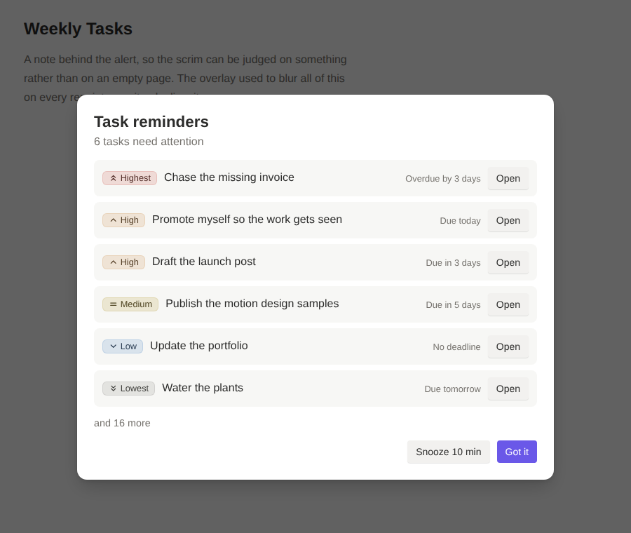</td>
<td>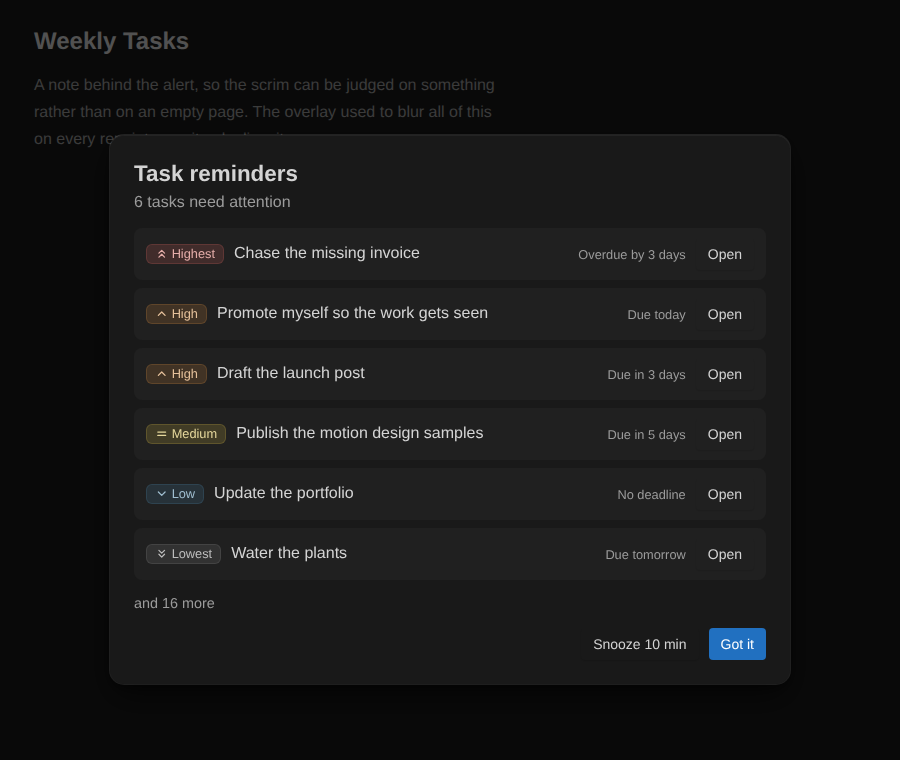</td>
</tr>
</table>

Reminders are read from the active note plus any notes you select under
**Settings → TaskPro → Reminders**. Every unfinished task counts; completed ones
are skipped.

- **Schedule:** fixed times of day, plus an optional repeat every N minutes, with
  quiet hours.
- **Per-note intervals:** each selected note has its own switch, interval and
  unit (minutes, hours, days or weeks), so a note can fire independently of the
  global schedule.
- **Filters:** by priority, by status, by how close the deadline is, and by how
  recently the task was first seen — the plugin keeps its own hidden index of
  when each task appeared, so nothing is guessed from file names.
- **Strictness:** a toast, a dismissible fullscreen alert, or one that holds for
  a few seconds before it can be acknowledged. Sound, snooze and system
  notifications apply to all three.

### Before a plan starts

A task planned for a time of day gets a notice shortly before it starts, 10
minutes by default: *Starts in 8 minutes*, the task, and its plan, with
**Done**, **Snooze 5 min** and **Open** (which takes you to the line). A
chime and a system notification come with it, each with its own switch under
**Remind Before a Plan Starts** in the Reminders tab, where **How Early** is
set too. Whole-day plans and tasks already done are left out. A plan is still
announced up to 10 minutes after its start, so one that came due while
Obsidian was closed is not lost, and it is announced once, across restarts.

One task can ask for a different time with **Remind me** in its menu (at the
start, 5, 10, 15 or 30 minutes or an hour before, no reminder, or as in
settings), which writes `@remind(15m)`, `@remind(1h)` or `@remind(off)` into
its line. A small bell on the plan chip shows a time of its own, and a
crossed-out bell no reminder.

**On a date…** in the same menu asks for a day (in the Gregorian or the Jalali
calendar) and a time, and reminds you at that moment, whether or not the task is
planned: `@remind(2026-10-05 09:30)`. It takes the place of the reminder before
the plan, since a task has one `@remind`. The notice says *Reminder* instead of
*Starts in…*, with the same **Done**, **Snooze 5 min** and **Open**, and shows as
a bell chip with the day and time (*Tomorrow, 09:30*) on the line, grey once it
has passed. It is announced once, up to 10 minutes late. **No reminder** replaces
it with `@remind(off)`, and **As in settings** (under a plan with a time) clears it.

### Active notes

Active-note reminders are on by default. Tasks that only appear through an
`![[embed]]` are not counted as belonging to the note doing the embedding — the
alert resolves the outer note's own file, so a callout like
`> ![[Other note#Heading]]` does not pull in tasks that are not really there.

## Telegram bot

Manage tasks and reminders from Telegram, even while your computer is off. It is
optional and off by default. Your notes stay the source of truth: Supabase holds
only a snapshot of your open tasks and a queue of what you asked for in Telegram.

- **A small app inside the chat.** `/start` opens a menu (Today, All tasks, New
  task, Overdue, Status, Settings). Lists come in sections (overdue, today,
  tomorrow, later, unplanned) set in quotes, eight tasks to a page, with filters;
  every step edits the same message in place, and the main buttons are coloured.
  English and Persian, Jalali dates understood.
- **Tap a task, change anything.** A task in a list opens its own screen: its
  card on top and a button for every setting under it (title, status, priority,
  deadline, plan, reminder, tags, repeat), each showing its value, with Done and
  Delete above. Status is open, in progress, done or not done (the four checkbox
  states of the notes), and the lists have a filter for what is in progress. A tab bar (home, today, all, new, settings) sits under the main
  screens. Pick a preset or reply with your own ("every 3 days",
  "friday"). New tasks are written in plain words ("call the bank tomorrow 10").
  Reminders arrive as a card with Done and Snooze buttons.
- **Telegram's rich messages.** Screens go out as rich messages (Bot API 10.1):
  real headings, tasks as a task list with subtasks nested under their parent, a
  task's settings as a table, written right to left in Persian. Clients or servers
  that do not take them get the same screen as a classic message, and **Settings →
  Rich display** turns them off. Short messages are held at a full card's width with
  invisible characters so their buttons are not squeezed, and **Settings → Message
  width** tunes how many (or turns it off). Filters sit two to a row, and ratios
  read "1 از 3", not a slash that turns round.
- **Pick a day on a calendar.** Reminder, plan, deadline and "New task for a day"
  open a month drawn as buttons, in the Jalali or the Gregorian calendar (Saturday
  first in Persian), with today in brackets, the current day ticked and a dot on
  days that have tasks; then the hour (and, for a plan, how long it lasts).
- **A task lands in its day's note.** A task made in Telegram is written into the
  note of the day it is planned, reminded or due on (else today), as one added on
  the calendar is, using the daily-note settings; with "New tasks go to the inbox"
  set, it goes there.
- **Subtasks, and lists that read in order.** Lists number the tasks 1 to the end,
  a parent is followed by its subtasks (marked ↳, with a count and a bar), and a
  card shows a parent's open subtasks or whose subtask it is.
- **Your tags are listed.** `/tags` (and the 🏷 button on the menu) lists every tag
  you have used, plus those defined under **Settings → Tags**, with how many tasks
  are open under each; tap one for its tasks or to start a new task with it. When a
  task's tags or a new task's tags are asked for, the tags you already have are
  buttons.
- **MarkdownV2.** Screens are sent as Telegram MarkdownV2 — bold labels, underlined
  headings, quotes, expandable quotes for long lists, code — with every reserved
  character escaped, and fall back to HTML and then plain text if Telegram refuses
  one.
- **An assistant, on Cloudflare Workers AI** (optional, free allowance). Say it in your
  own words, or send a **voice message**, and the assistant puts tasks on the right days:
  “call Sara tomorrow at 9 and buy bread in the evening”, “plan my study for Thursday’s
  exam”, “move Saturday’s meeting to 5”, “task 12 is done”, “what do I have tomorrow?”.
  A model (the same service Agenter uses) works through commands we give it — add a task,
  change one, set a status, propose a deletion, look tasks up — and every field it sends is
  checked first (a day that is not a day, an hour that cannot be, a reminder in the past,
  a wrong year). The card that comes back shows what was made, with its day and hour in
  plain words, a button to open each task, and **Undo**; the next sentence is understood
  with what came before (“no, Friday”). Voice goes through Whisper on the same account.
  Needs two secrets (`CF_ACCOUNT_ID`, `CF_API_TOKEN`); see the setup guide. **Settings →
  Assistant** turns it off, and `/ai your words` calls it by name.
- **The bot speaks first.** A morning summary, an evening review (with a button that moves what
  is left to tomorrow), a message the evening before a deadline, and a reminder that comes
  again until the task is ticked, each set in **Settings → Notifications**. `/overview` shows the
  **week day by day** (every task of each day, the ones with no hour too, a heading with how many in
  brackets; no table) and `/day` one day; the two are a switch on the same screen. The days and weeks
  beside the one shown are named by their dates, never «tomorrow» or «last week».
- **Plan my day, shown first.** `/planday` has the assistant fit what has no hour into the free
  hours and show the plan; nothing is changed until you tap Apply (always, only for big jobs, or
  never: your choice). It can also break a task into steps, which the plugin writes as
  subtasks under it.
- **Dates that adapt.** A task card's plan and reminder are Telegram date entities: your
  words stay, a tap shows the exact time on your own clock, and a live countdown sits
  beside them. Page numbers and the blanks of a calendar are disabled buttons, and the
  assistant answers with a 👀 on your message, Telegram's own «Thinking…» placeholder while it
  works (gone when the answer arrives) and a reply that hangs from what you wrote. Counts on the buttons sit in brackets: «امروز (۳)».
- **Only for you.** Set `ALLOWED_USER_ID` (your Telegram id; `/id` tells you) and the bot
  answers nobody else, not even to say so.
- **In Obsidian:** a background sync (every 2 minutes by default; your edits are sent a few seconds after you stop typing, and on **Sync
  Telegram now**) uploads the snapshot, then applies what you asked for in
  Telegram to your notes: new tasks go to the board's inbox note, the rest edit
  the task's own line (a rename keeps the task's number in the bot). Each command
  is acknowledged once, so a dropped connection never applies one twice.
- **While Obsidian is closed:** reminders still fire from the last snapshot;
  changes you make in Telegram wait and are applied the next time Obsidian opens.

Set it up once with [`supabase/README.md`](supabase/README.md) (Persian; about ten
minutes: a bot token from BotFather, three secrets, `supabase db push`, deploy the
three Edge Functions). Updating later is one double-click on `update-bot.bat` (the
functions bring the database up to date themselves). Then open **Settings →
TaskPro → Telegram**, turn it on and paste the function address and the sync
token. The tokens live in Supabase secrets and in the plugin's settings file,
never in your notes.

## Settings

| Tab | Holds |
| --- | --- |
| **General** | Reference note, target folder restriction |
| **Badges** | Chip language, size, calendar system, embed visibility, a switch per optional chip (subtask progress and waiting included), and the `@` suggestions on task lines |
| **Capabilities** | Focus-timer duration, desktop notification, sound, status-bar readout; a note on how repeat intervals are counted |
| **Tags** | Tag chips on or off, and the tag list: create, rename, recolour, delete |
| **Calendar** | [Daily notes](#daily-notes): folder, name formats, template, heading; planning: where new tasks go, week start, 12- or 24-hour clock, the hour the grid opens at, snap, and new block length |
| **Reminders** | The reminder before a plan starts (how early, sound, system notification); schedule, note sources, filters, strictness, sound |
| **Internal Tasks** | Tasks stored in the plugin rather than a note |

Chip colours, padding, radius and opacity are exposed to the
[Style Settings](https://github.com/mgmeyers/obsidian-style-settings) plugin.

## How it works

- CodeMirror 6 `ViewPlugin` for Live Preview chips; `MarkdownPostProcessor` for
  Reading Mode.
- Chips are decorations, so the markers stay out of the rendered line and out of
  the file's visible text.
- All writes go through `Vault.process()`, which re-reads under the vault lock —
  a concurrent edit is never clobbered.
- Focus timers share one interval that only exists while a timer is running, and
  countdown chips are retargeted in place instead of by rebuilding editor
  decorations, so a per-second update never fights the cursor.
- Mappings, progress and timers live in `data.json`, keyed by block ID, so the
  markdown stays clean. Tag names and colours live there too; a note holds only
  the key.
- The chip menu, the board and the commands edit a task through one path, which
  finds the line (by the line number it was read from while that line is
  unchanged, then by block ID, then by text), rewrites it under the vault lock,
  and syncs a linked copy. Renaming a task moves its sync mapping with it.
- Obsidian loads a theme's stylesheet after every plugin's, so a theme wins any
  specificity tie. The board's controls are scoped one class above a theme's
  generic `button` and `input` rules, its checkbox glyphs are CSS masks rather
  than icons (so a theme's icon-button sizing never reaches them), and coloured
  button states are background images, which a theme's `button:hover` colour
  paints under rather than over. That is what keeps the board looking the
  same under any theme.
- The task board keeps an index of every task that follows the vault's metadata
  events. It is built the first time the board (or a tag count) needs it, after
  Obsidian's layout is ready, and costs nothing until then.
- Chip colour is one recipe — tint a background and a border out of an accent,
  and mix the label toward the theme's text colour — so a new chip is a single
  custom-property assignment and inherits the theme adaptivity for free.
- The calendar is drawn from the same task index as the board, plus the tasks
  of the daily notes in view, which are found by working each day's note path
  out from its date rather than by searching the vault. Dates are kept as
  `YYYY-MM-DD` keys and counted in UTC, so a daylight-saving change never
  shifts a day. The Jalali calendar is a way of reading those keys, converted
  with the same arithmetic the deadline picker uses, so no date library is
  involved and a note always stores the Gregorian date.
- Overlapping blocks share a day's column in lanes, as in a calendar app. Drags
  are pointer events with a small threshold, so a click still opens a task and
  a drag works the same with a mouse, a pen or a trackpad; on a touch screen a
  tap opens the task, so scrolling is left alone. While a drag or a card is
  open, a note change is held back and redrawn afterwards, so the calendar
  never redraws under your pointer.
- A task's parent is read from the list structure of its note while the note
  is parsed: the nearest task among the list items it is nested under, past
  any plain bullets in between, and a paragraph at the margin ends the list.
- Mixed Persian and Latin text is kept in order with Unicode isolates rather
  than by hoping the bidi algorithm guesses right: a note name or a task title
  dropped into a sentence is isolated, and a Latin-digit time range is held
  left to right, so `09:00 – 10:30` never reads `10:30 – 09:00` in Persian.
- A dependency is a block link, resolved the way Obsidian resolves one (the
  full path, then a path's end, then a note's name), so a task waited on is
  found wherever its note moved. Cycles are found by walking the links before
  one is added.
- Reading view hands a post-processor a parent task's `<li>` with its
  subtasks' list inside it, so each task's markers are read from, and hidden
  in, its own line only, and its chips go before its subtasks.
- The phone layout is chosen by the board's own width, not by the device, so
  it follows a pane being resized. On a phone Obsidian counts its floating
  bar in `--view-bottom-spacing`, and the board keeps its last row and its +
  button above that.
- `Esc` goes to the innermost thing open. Obsidian handles keys before the
  page does, so a card or a drag pushes a keymap scope of its own: the first
  `Esc` closes the card, and only the next one closes the floating board.
- Spacing comes from one scale of tokens (`--taskpro-space-1` to `-8`: 2, 4, 6,
  8, 10, 12, 16 and 24px) and rings from one halo (`--taskpro-halo`, 4px). A
  ring, such as a focus ring or the one around a hovered task's family, is
  drawn outside its element, so any box that clips its children (`overflow`
  other than visible) pads itself by the halo and leans out by as much: the
  children stand where they did and the clip edge is a halo further out. A box
  with no room to spare draws its ring inside. `test/clip-guard.mjs` walks every
  view and fails on a ring that an ancestor cuts.
- Motion is CSS, in one section of the stylesheet that a reduced-motion setting
  switches off, and only opacity and transform move. `ui/motion.ts` decides
  which elements play: the board asks for an entrance when the layout, the
  grouping or a filter changes, and compares each redraw with the last to find
  the tasks that just arrived or changed status. A redraw for any other reason
  plays nothing.
- Moving a task cuts its block out of one note (with what is nested under it),
  changes the block IDs the other note already uses, sets the block down there,
  and then carries what is kept elsewhere: progress and timers in `data.json`,
  the sync mapping, and the `@waiting` links on both sides. If the second note
  cannot be written, the first gets its lines back untouched.
- The bar over a selection builds its menus with the same functions as a
  single task's menu, given a stand-in task with what all the picked share and
  a host that applies each change to every picked task in turn (one write at a
  time, since two writes to one note at once would leave the second reading a
  note the first had changed).
- No full-screen `backdrop-filter`. Blurring the window behind an overlay makes
  the compositor re-blur everything whenever anything above it repaints, which
  is why the reminder alert used to feel sluggish with a long task list. The
  overlays dim instead, and `contain` keeps their repaints local.

## Development

```bash
npm install
npm run dev     # watch build
npm run build   # typecheck + production build
npm test        # markers, recurrence, timers, board data (the keyboard cursor, nesting, saved views), subtasks and waiting, moving a task between notes, plan reminders, the timeline's model, calendar dates and daily notes, and the plugin's edit paths
```

`npm test` includes an integration test (`test/plugin-edits.mjs`) that loads the
whole plugin against an in-memory vault (`test/harness/obsidian-node-mock.mjs`)
and drives the same edit path the chip menu and the board use: status,
priority, deadline, tags and renames, tag sync to a source note, the tag list,
removing a tag from every note, plans and how they roll forward, and daily
notes created from a template, and the moves between notes (a block ID that
collides, tasks waiting on the moved one, a note that refuses the write, deleting
several tasks and undoing it). `test/calendar.mjs` covers the calendar's date
arithmetic in both calendars, name formats, templates and block layout, and
`test/relations.mjs` the subtask counts, `@waiting` links and cycles, how a
moved block is rewritten, when a plan's reminder is due, and how the timeline
lays tasks out.

The distributable files are `main.js`, `manifest.json`, and `styles.css`.

### Previews

`test/` holds offline harnesses that load the real `styles.css` over Obsidian's
default theme variables (`test/obsidian-theme.css`) and reproduce the DOM the
plugin builds. Open one in a browser to check a style change without reloading
Obsidian:

| File | Shows | Query flags |
| --- | --- | --- |
| `test/chips-preview.html` | Task lines with every chip, and each chip's states | `?light`, `?theme=<name>` |
| `test/reminder-preview.html` | The reminder alert | `?light`, `?theme=<name>`, `?strict` |
| `test/board-preview.html` | The task board, calendar, timeline, tag picker, tag manager and tag chips, built by the plugin's own classes | `?light`, `?theme=<name>`, `?layout=<board\|calendar\|timeline>`, `?mobile=1` (the phone layout), `?cal=<month\|week\|day\|agenda>`, `?system=jalali`, `?group=<tag\|priority\|…>`, `?lang=fa`, `?density=<compact\|comfortable\|spacious>`, `?wrap=on`, `?hideempty=on`, `?views=demo` (with some saved views), `?view=<picker\|manager\|note\|palette>` |

`board-preview.html` loads a bundle of the real board code against a stub host
whose edits land in in-memory notes, so it can be clicked through like the
real thing. Build it with `node test/harness/build.mjs` (the preview and test
scripts below do this themselves).

`?theme=<name>` stacks `test/themes/<name>.css` between Obsidian's defaults and
the plugin's sheet, in the order Obsidian loads them — which is how the
community-theme screenshots above were produced, and how a theme is checked
before claiming the chips adapt to it. Drop any theme's `theme.css` into
`test/themes/` to try it.

```bash
npm i --no-save playwright@1.56.1 lucide-static && npx playwright install chromium

npm run previews        # regenerate the images in this README
npm run check:contrast  # measure every chip, board and tag colour against WCAG AA on every theme
npm run test:ui         # click and drag through the board, calendar and timeline, then again with a finger on a phone-sized screen (and an accessibility sweep of every screen of it), the Reading view's chips, and the clip guard (no ring cut by the box around it, in every view)
```

These need Playwright, and the board harness needs Lucide's icon set (the icons
Obsidian ships). Neither is a dependency — they would pull a browser and an
icon set into every install — so `npm test` stays independent of them and
covers the logic instead.

## Privacy before sharing

See [SECURITY.md](SECURITY.md) before publishing this repository, a build, a vault or diagnostics. The Windows updater now requires a locally linked Supabase project (or `SUPABASE_PROJECT_REF`); it no longer targets a personal project. Raw exceptions are not logged or persisted by sync, and the local token field is masked, but plugin `data.json` still contains your configured token and must never be shared.

## Version 1.6.0

New tasks are planned after three seconds of quiet typing; optional start/end tracking and matching Telegram behavior are included. Long chip rows scroll with the mouse wheel, trackpad, touch and keyboard in either writing direction. Reduced-motion layouts are stable from their first frame, and table focus rings stay visible in clipped cells. Existing board, calendar, timeline, tags, reminders and theme-adaptive checkbox behavior are retained.

## Releasing

1. Update the version in `manifest.json`, `package.json` and
   `package-lock.json`.
2. Add the version and its minimum Obsidian version to `versions.json`.
3. Commit and push.
4. Tag the commit with exactly the manifest version, no `v` prefix:

   ```bash
   git tag 1.5.0
   git push origin 1.5.0
   ```

The workflow checks that the tag, manifest, package, lockfile and
`versions.json` all agree, runs the tests, builds, and publishes `main.js`,
`manifest.json`, `styles.css`, and `taskpro-<version>.zip` holding the same
three files.

### Releasing without a local tag

The same workflow runs from the **Actions** tab, which helps when you cannot
push a tag from a clone:

| Input | Effect |
| --- | --- |
| *(none)* | Builds and uploads the zip and the three loose files as run artifacts. Nothing is tagged or published. |
| **publish** | Also creates the tag — taken from `manifest.json`, so the metadata check still has to pass — and the release with all four assets. |
| **target** | The commit-ish to build and tag. Defaults to the branch the run was started from; set it to `main` to release from the default branch. |

`gh release create` refuses to overwrite an existing release, so a version can
only be published once.

See [CHANGELOG.md](CHANGELOG.md) for what changed in each version.

## License

Released under the [GNU General Public License v3.0](LICENSE).
